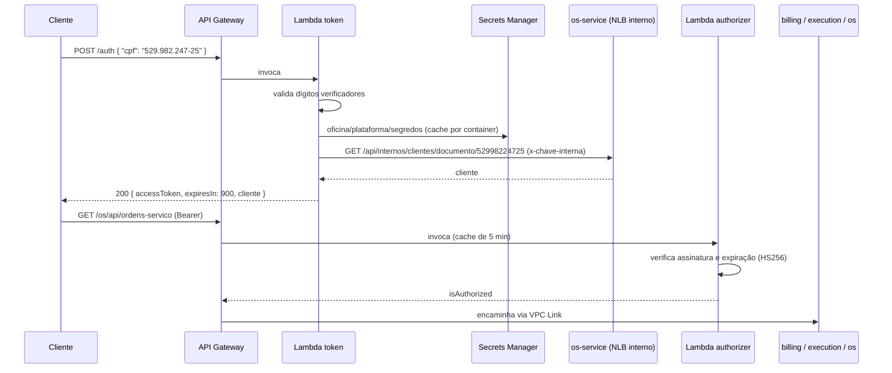
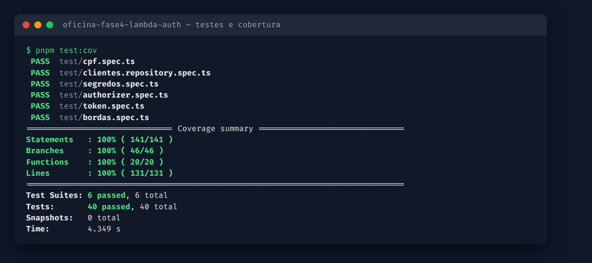

# oficina-fase4-lambda-auth

**Autenticação serverless por CPF** da plataforma da oficina — Tech Challenge SOAT, Fase 4.

Duas funções Lambda atrás do API Gateway:

| Função | Papel |
| --- | --- |
| **`oficina-auth-token`** | Valida o CPF, confirma no **os-service** que o cliente existe e emite um JWT de 15 minutos |
| **`oficina-auth-authorizer`** | Valida o JWT em toda rota protegida do gateway (os, billing e execution) |

## O que mudou da fase 3

Na fase 3 a função de token lia a tabela `clientes` direto no RDS. Na fase 4 cada microsserviço tem banco próprio e **nenhum componente acessa o banco de outro**, então a função passou a consultar a rota interna do os-service (`GET /api/internos/clientes/documento/:cpf`), pelo NLB interno, autenticada pela chave `INTERNAL_API_KEY`. O driver `pg` saiu e o pacote ficou autocontido (~20 KB por função).

As funções agora são **criadas pelo repositório de infra** ([oficina-fase4-infra](https://github.com/fdacmatheus/oficina-fase4-infra)) com código provisório; este repositório só publica o código. Isso quebra a dependência circular entre o authorizer do gateway e a Lambda.

## Arquitetura



## Tecnologias

- **Node.js 20** + **TypeScript** (strict), empacotado com **esbuild**
- **jsonwebtoken** (HS256) · `fetch` nativo para o os-service
- **AWS Secrets Manager**: `oficina/plataforma/segredos` (`JWT_SECRET`, `INTERNAL_API_KEY`), o mesmo segredo usado pelos 3 serviços
- **Jest** — 40 testes, **100% de cobertura**
- **GitHub Actions** (gitleaks, CodeQL)

## API

### `POST /auth`

```bash
curl -X POST "$API_GATEWAY_URL/auth" -H 'content-type: application/json' -d '{"cpf": "529.982.247-25"}'
```

```json
{ "accessToken": "<jwt>", "expiresIn": 900, "cliente": { "id": "3f2a...", "nome": "João da Silva" } }
```

| Status | Código | Quando |
| --- | --- | --- |
| `400` | `CPF_INVALIDO` | CPF ausente, malformado ou com dígito verificador incorreto (recusado sem sair da Lambda) |
| `404` | `CLIENTE_NAO_ENCONTRADO` | CPF válido, mas o os-service não conhece o cliente |
| `500` | `ERRO_INTERNO` | os-service ou Secrets Manager indisponível |

Toda resposta traz `x-correlation-id` (o `requestId` do gateway), presente em todas as linhas de log JSON.

## Configuração

| Variável | Função | Origem |
| --- | --- | --- |
| `SEGREDOS_NAME` | nome do secret da plataforma | Terraform do repo de infra |
| `OS_SERVICE_URL` | `http://<NLB interno do os-service>` (só a função de token) | Terraform do repo de infra |
| `JWT_SECRET` + `INTERNAL_API_KEY` | atalho para teste/local: dispensam o Secrets Manager | — |

## Desenvolvimento

```bash
pnpm install
pnpm test:cov    # testes com cobertura (mínimo 95%)
pnpm package     # gera build/token.zip e build/authorizer.zip
```

### Evidências de cobertura



## CI/CD

- **PR e push na `main`**: lint, typecheck, testes com cobertura, **gitleaks**, empacotamento; **CodeQL** em paralelo.
- **`main` com `DEPLOY_ENABLED=true`**: `aws lambda update-function-code` nas duas funções + smoke test (um token inválido precisa ser negado pelo authorizer).
- `main` protegida: merge só por PR com os checks verdes.

## Decisões

**Duas funções, não uma.** O authorizer roda em toda requisição protegida; a emissão de token, só no login. Separadas, o authorizer fica fora da VPC (sem cold start de ENI) e menor.

**Authorizer `REQUEST`, não `JWT` nativo.** O authorizer JWT do API Gateway exige emissor OIDC com JWKS; o token é HS256 com segredo compartilhado, então a validação é em código, com cache de 300 s no gateway.

**Validação de CPF duplicada de propósito.** A regra é a mesma do validador do os-service; importar o pacote do serviço traria o NestJS para dentro do bundle. A duplicação é coberta por testes dos dois lados.

**`LabRole` como role de execução.** O AWS Academy não concede `iam:CreateRole`.
